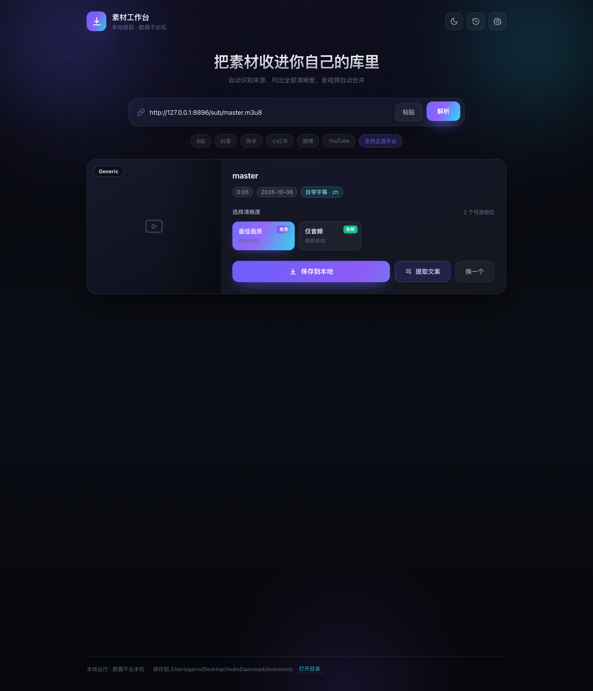
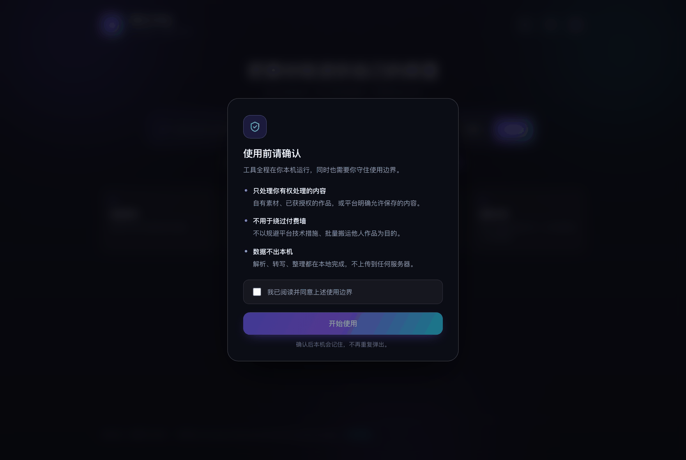
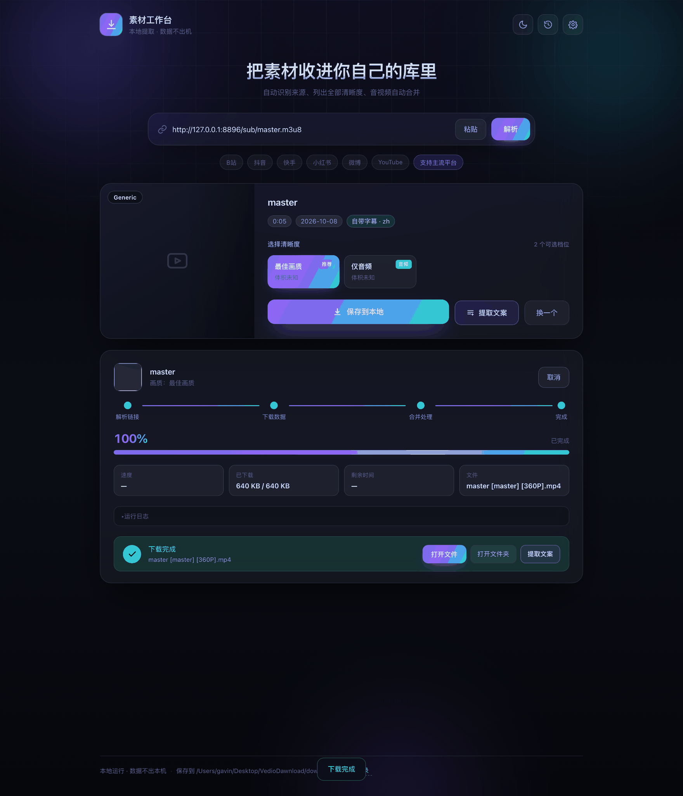
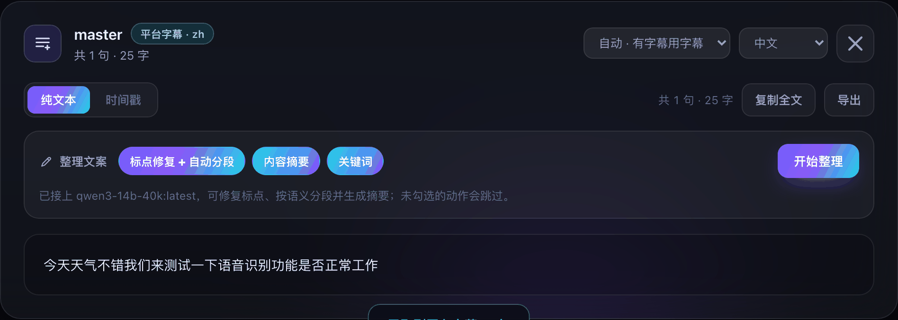
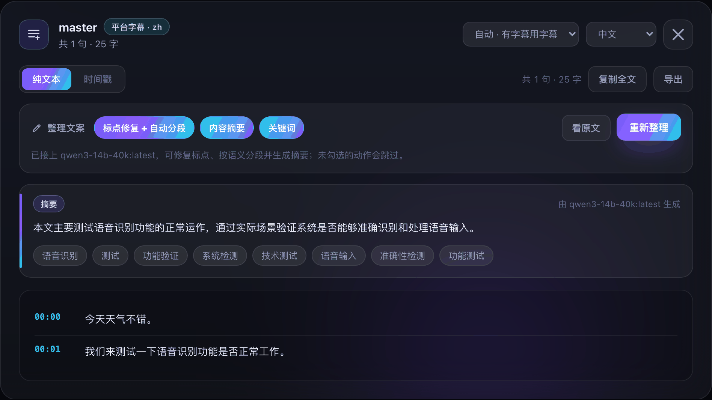
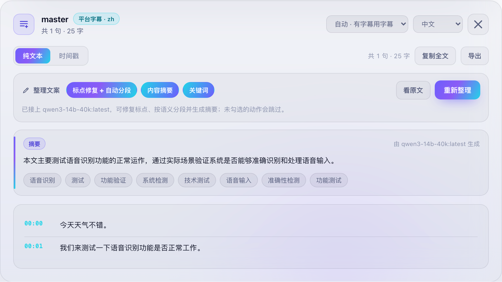
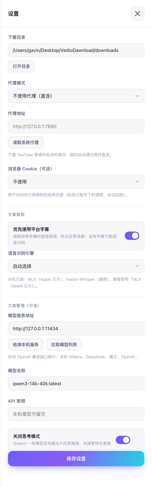
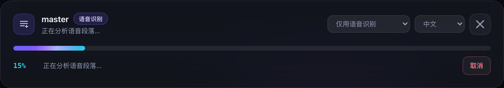

# 片语 · Pianyu

> 一条链接，片语成章。
> 把你有权处理的音视频收进本机，再把里面的话变成能用的文字。
> **解析 → 下载 → 字幕/转写 → 整理 → 结构化文案**，一条产线跑完，全程本机运行。

[](LICENSE)
[](https://www.python.org/)
[](#环境要求)
[](#环境要求)



**它解决什么问题**：一个两小时的访谈视频，你想拿里面的内容改稿 —— 现在的流程是「下载 → 转文字 → 自己排版 → 再整理成稿」，四五个工具来回倒。片语把这条链路收成一个本地页面：粘链接、点一下，最后拿到一份带章节和摘要的 Markdown。

**它不做什么**：不分发、不上传、不中转，不做批量搬运。

---

## 为什么是本地

| | 云端工具 | 片语 |
|---|---|---|
| 音视频文件 | 上传到对方服务器 | 只在本机磁盘 |
| 转写 | 依赖网络与配额 | 本机推理，断网可用 |
| 数据留存 | 取决于对方隐私政策 | 你自己决定什么时候删 |
| 成本 | 按时长/次数计费 | 一次装好，跑多少都不额外花钱 |

---

## 核心能力

- **字幕优先**：视频自带字幕时直接抓文本，**秒出且零误差**（不过语音识别，不会有错别字）
- **双识别引擎**：Apple 芯片走 MLX（快），其它平台走 Faster-Whisper，模型 `large-v3-turbo`
- **文案整理**：接本机 Ollama / LM Studio 或任意 OpenAI 兼容接口，做标点修复、语义分段、摘要、关键词
- **结构化输出**：导出 `.md` / `.srt` / `.txt` / `.json` / `.docx` / `.pdf`
- **零第三方运行时依赖**：主程序只用 Python 标准库，下载引擎 yt-dlp 内嵌

---

## 使用边界

首次启动会弹一次**使用边界确认**，确认后才进入主界面：



这个工具只做「本地处理」，不做「内容分发」。它适用的场景是：

- **你自己的作品与素材** —— 自拍视频、自家课程、企业内训、会议回放
- **你已获授权的作品** —— 客户交付、合作方授权的内容
- **平台明确允许保存的内容**，以及公共领域作品

请勿用于绕过付费墙、批量搬运他人作品，或任何侵犯版权的用途。
工具本身不经任何服务器中转数据，也不提供内容检索或分发能力。

---

## 界面预览

| 解析结果 | 保存完成 |
|---|---|
|  |  |

文案提取与整理：

| 提取完成（命中平台字幕） | 大模型整理完成 |
|---|---|
|  |  |

浅色主题：

| 整理结果 | 设置面板 |
|---|---|
|  |  |

---

## 快速开始

### macOS / Linux

双击 **`一键启动.command`**（或 `start.command`）。

> 首次双击若提示"无法打开"，右键 → 打开，或先在终端执行一次：
> `chmod +x 一键启动.command`

### Windows

双击 **`一键启动.bat`**（或 `start.bat`）。

首次运行会自动准备运行环境、安装下载引擎，大约需要 10 秒。之后启动在 2 秒内完成。

浏览器会自动打开 <http://127.0.0.1:8760>。

---

## 使用

1. **准备素材链接** —— 你自己账号下的内容，或已获授权的链接
2. **粘贴**进输入框 —— 会自动开始解析
3. 在解析结果里**选择清晰度**，点**保存到本地**

保存完成后可以直接「打开文件」或在文件夹中定位。

---

## 提取文案

三种入口，任选其一：

- 解析出视频后，点 **「提取文案」** —— 只抓取音频，不下载整个视频
- 保存完成后，在完成面板点 **「提取文案」**
- 直接把电脑里的**视频 / 音频文件拖进网页**

提取过程会实时显示进度与已识别的句子：



### 字幕优先

解析时就会探测该视频有没有**平台自带字幕**（解析结果里显示「自带字幕 · zh」）。
提取时：

- **有字幕** → 直接抓字幕文本，**秒出且零误差**（不经过语音识别，不会有错别字）
- **没有字幕** → 自动改跑语音识别，进度里会提示「该视频没有平台字幕，改用语音识别」

想强制走某一条路，在文案面板右上角切换：

| 模式 | 行为 |
|---|---|
| 自动（有字幕用字幕） | 默认。有字幕抓字幕，没有就跑识别 |
| 仅用平台字幕 | 只抓字幕；没有就报错，不做识别 |
| 仅用语音识别 | 忽略字幕，强制转写音频 |

> 实测（5 秒测试片段，本机 Apple 芯片）：抓字幕 0.22 秒，语音识别 3.16 秒。
> 视频越长差距越大 —— 抓字幕的耗时几乎与视频时长无关，识别则随时长线性增长。

### 结果处理

- 在 **纯文本** / **时间戳** 两种视图之间切换
- **复制全文**，或导出为 **.txt** / **.srt 字幕** / **.md**
- 识别语言默认中文，可切换英文或自动识别

来源会标在标题旁：`平台字幕 · zh` 表示文本来自字幕，没有标记则来自语音识别。

---

## 文案整理（可选）

转出来的文字稿往往没有标点、一段到底。整理功能可以把散句收拢成可读的文章。

三个动作用开关控制，可以只开其中几个：

| 动作 | 说明 | 需要大模型 |
|---|---|---|
| 标点修复 + 自动分段 | 补标点、按语义切段 | 否（本地也能跑基础版） |
| 内容摘要 | 生成一句话摘要 | 是 |
| 关键词 | 提取若干关键词 | 是 |

**完全没配大模型也能用** —— 本地规则会先跑一遍：去重、按停顿分段、标点全角化。
配了大模型才会额外做「按语义改写分段 + 摘要 + 关键词」。

点 **「看原文」** 可以随时对照原稿，不会破坏已提取的结果。

### 接哪个大模型

任何 **OpenAI 兼容接口**都能接，在设置里填三项：

| 场景 | 模型服务地址 | 模型名称 | API 密钥 |
|---|---|---|---|
| 本机 Ollama | `http://127.0.0.1:11434` | `qwen3:14b` | 留空 |
| 本机 LM Studio | `http://127.0.0.1:1234` | 看 LM Studio 里加载的模型 | 留空 |
| DeepSeek | `https://api.deepseek.com` | `deepseek-chat` | 填自己的 Key |
| OpenAI | `https://api.openai.com` | `gpt-4o-mini` | 填自己的 Key |

设置里有 **「检测本机服务」**（自动探测 Ollama / LM Studio / vLLM 的常见端口）
和 **「拉取模型列表」**（直接列出该服务上已装的模型，点选即可）。

> **关闭思考模式**默认开启。Qwen3、QwQ 这类模型默认会先输出一大段思维链再给结果，
> 整理文案不需要这些，关掉更快也更省。若你用的模型不支持该开关，取消勾选即可。

> **隐私**：接本机模型时全程不出本机；接云端接口时，**转写后的文字**会发送到该服务 ——
> 音频文件本身不会外传。

---

## 功能

| 能力 | 说明 |
|---|---|
| 自动识别来源 | 链接粘进去就能识别，不需要选平台 |
| 清晰度选择 | 自动列出全部可用档位，并预估文件体积 |
| 智能推荐 | 默认选中 ≤1080P 的最高画质（画质与体积的平衡点） |
| 音视频自动合并 | 高清流是音视频分离的，自动用 ffmpeg 合并 |
| 实时进度 | 速度、已下载大小、剩余时间、分片进度 |
| 仅音频 | 可只提取音轨（M4A） |
| 下载记录 | 保留任务历史与状态 |
| 代理支持 | 三种模式，默认直连；可只对境外站点走代理 |
| 单条处理 | 一次只处理一个链接，不做批量搬运 |
| 明暗主题 | 右上角一键切换 |
| 随时取消 | 处理过程中可中断 |
| **字幕优先** | 有平台字幕就直接抓，秒出且零误差 |
| **文案提取** | 把视频语音转成文字稿（纯文本 / 时间戳 / SRT / Markdown） |
| **本地文件提取** | 视频、音频文件直接拖进网页即可转文字 |
| **双识别引擎** | Apple 芯片走 MLX，其它平台走 Faster-Whisper |
| **文案整理** | 接本机 / 云端大模型做标点修复、语义分段、摘要与关键词 |

---

## 设置说明

点右上角齿轮进入设置。

**下载目录** —— 素材保存位置，默认为本项目的 `downloads/` 文件夹。

**代理模式**

| 模式 | 行为 |
|---|---|
| 不使用代理 | 全部直连（默认，最稳） |
| 智能 | **仅境外站点**走代理，国内站点直连 |
| 所有站点 | 统一走代理 |

> 为什么要分模式：国内站点走境外代理往往更慢，甚至被目标站拒绝；
> 而部分境外站点通常又必须走代理。智能模式按域名自动分流。
> 需要填代理时点「读取系统代理」可自动填入本机环境变量里的地址。

**浏览器 Cookie** —— 当你要处理的内容需要登录才能访问（且你有权访问）时，选择对应的浏览器。
浏览器需处于登录状态。本工具只读取浏览器已有的登录状态，不绕过任何付费限制。

**优先使用平台字幕** —— 默认开启。关掉后一律走语音识别。

**语音识别引擎** —— 默认「自动选择」。本机装了哪个就用哪个；
两个都装了时，Apple 芯片优先 MLX（更快）。也可以在文案面板里按次指定。

**模型服务地址 / 模型名称 / API 密钥 / 关闭思考模式** —— 见上文「文案整理」。

---

## 目录结构

```
Pianyu/
├── start.command          macOS / Linux 启动脚本
├── start.bat              Windows 启动脚本
├── setup-asr.command      文案提取环境安装（macOS / Linux）
├── setup-asr.bat          文案提取环境安装（Windows）
├── app.py                 启动入口（拉起服务 + 打开浏览器）
├── server.py              HTTP 服务：路由、JSON API、SSE 进度推流
├── downloader/
│   ├── config.py          配置读写（config.json）
│   ├── engine.py          yt-dlp 封装：解析、画质聚合、下载
│   ├── tasks.py           下载任务管理：状态机 + 事件广播
│   ├── subtitles.py       平台字幕抓取与解析（VTT / SRT / json3 / B站）
│   ├── asr.py             文案提取任务管理：字幕优先 + 音频抓取 + 子进程编排
│   └── polish.py          文案整理：本地规则 + 大模型（OpenAI 兼容）
├── tools/
│   ├── asr_worker.py      转写 worker（跑在独立环境里，双引擎）
│   └── asr_setup.py       识别模型下载与自检（安装脚本调用）
├── static/                前端（原生 HTML / CSS / JS）
├── downloads/             默认保存目录
├── .venv-asr/             文案提取的独立环境（跑过安装脚本后出现）
├── config.json            自动生成，可直接编辑
└── requirements.txt
```

---

## 环境要求

- **Python 3.10+**
- **ffmpeg** —— 强烈建议安装。缺了它，音视频分离的高清流无法合并
  - macOS：`brew install ffmpeg`
  - Windows：`winget install Gyan.FFmpeg`

主程序只用 Python 标准库，第三方依赖只有 yt-dlp 一个包。
语音识别与文案整理都跑在**独立环境**里，不装也不影响主程序。

---

## 文案提取环境（可选）

语音识别跑在独立环境 `.venv-asr` 里，与下载功能完全隔离。

**安装**：双击 `setup-asr.command`（macOS / Linux）或 `setup-asr.bat`（Windows），只需一次。
它会按平台自动选好后端、创建环境，并从国内镜像（hf-mirror）拉取模型。

**平台与后端**

| 平台 | 后端 | 速度参考（1 小时视频） |
|---|---|---|
| macOS（Apple 芯片） | `mlx-whisper` | 约 3~5 分钟 |
| macOS（Intel） | `faster-whisper`（CPU） | 明显更慢，视 CPU 而定 |
| Windows | `faster-whisper` | 有 NVIDIA 显卡走 CUDA，否则 CPU |
| Linux | `faster-whisper` | 同上 |

默认模型都是 `whisper-large-v3-turbo` 档位，中文效果最好的一档之一。
**全程本地推理，音频不出本机。**

想强制指定后端：

```bash
./setup-asr.command faster     # 或 mlx
```

安装脚本是幂等的，随时重跑都可以 —— 已装好的部分会跳过。

> 若只想换模型、不重装依赖，可以直接跑：
> `.venv-asr/bin/python tools/asr_setup.py --engine mlx --model <仓库名>`

---

## 常见问题

**解析失败，提示「未取到视频流」**
目标平台触发了频率限制。等几分钟再试；若是需要登录才能访问的内容，
可在设置里选择对应的浏览器 Cookie。

**没有声音 / 只有画面**
缺少 ffmpeg。装好后重新处理。

**清晰度里没有 1080P 以上**
平台对高清晰度有会员或登录要求。本工具只读取你已有权限的内容，
不会绕过任何付费限制。

**打不开 / 端口被占用**
服务会自动顺延端口（8760 → 8799）。看启动时的终端输出里的实际地址。

**想改文件名格式**
编辑 `config.json` 里的 `filename_template`。画质标签会自动注入，
所以同一视频的不同清晰度不会互相覆盖。

**「提取文案」按钮是灰的**
文案提取环境还没装。双击 `setup-asr.command` / `setup-asr.bat` 装一次即可。

**提取出来是空的 / 不太准**
先确认视频里确实有人说话 —— 纯音乐、环境音会被自动过滤。
中英混排可试试切换识别语言；音质差、多人抢话会明显影响准确率。
有平台字幕的视频建议保持「自动」模式，字幕比识别准得多。

**「仅用平台字幕」报错说没有字幕**
该视频确实没带字幕，切回「自动」或「仅用语音识别」。

**「拉取模型列表」拉不到**
先点「检测本机服务」看看地址对不对。Ollama 需要先 `ollama serve` 起来；
端口不是默认值时手动改一下地址（只填 `http://127.0.0.1:端口` 就行，`/v1` 会自动补）。

**整理出来的摘要跟原文对不上**
模型偶尔会过度发挥。面板里「看原文」可以随时对照；
字数变化超过 40% 时界面也会提醒，建议重点核对。

**模型下载失败**
多半是网络。脚本默认走 hf-mirror；想换回官方源：
`HF_ENDPOINT=https://huggingface.co ./setup-asr.command`

---

## 说明

本工具全程在你本机运行，不上传、不中转、不分发任何内容。

请仅用于处理**你有权访问、有权处理**的内容，并遵守各平台的服务条款与版权规定。

---

## 许可证

本项目以 **MIT License** 开源，见 [LICENSE](LICENSE)。

内嵌的 yt-dlp（Unlicense）、语音识别权重（MIT / 上游基座 Apache-2.0）
以及可选的 ASR 运行时依赖，各自按其原始许可执行，清单见 [NOTICE.md](NOTICE.md)，
许可全文见 [LICENSES/](LICENSES/)。

## 贡献

欢迎提 Issue 与 PR。请注意三点：

1. 不要提交任何真实 Cookie、账号凭据或他人版权内容；
2. 涉及内嵌 yt-dlp 的改动请走 `yt_dlp_plugins/` 扩展点，不直接改 `vendor/` 下的上游源码；
3. 提交前跑一遍 `python3 -m unittest discover -s tests -v` 与 `python3 verify_smoke.py`。

